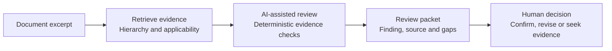

# Evidence-grounded AI for construction tendering

**From document excerpts to traceable evidence and human review.**

A research prototype for reviewing construction procurement and contract documents. It connects potential issues to source passages, checks whether the evidence supports a conclusion, and prepares findings for professional review.

**[See the offline walkthrough](docs/portfolio/WALKTHROUGH.md)** · **[Inspect the generated results](docs/portfolio/sample-results/RESULTS.md)** · **[Reproduce the checks](#run-it-locally)**

## The industry problem

Procurement review involves more than finding a relevant rule. Reviewers need to locate the document passage, establish which sources apply, identify missing information, and decide what needs professional judgment. This project explores how AI can make that work more structured and inspectable.

Construction and engineering management are the initial application domains. The broader research interest is **industry digitalization**: how AI tools can improve decision processes and, when supported by evidence, productivity. Transfer to other sectors is a future research direction.

## For product and applied AI teams

The product goal is a review aid that makes its evidence and unresolved questions easy to inspect.

| Workflow need | Implemented response | Explore |
| --- | --- | --- |
| Find evidence with the right authority and scope | Four-level cascade retrieval with jurisdiction and project-type checks | [Retriever](phase2_public/src/hierarchy_cascade_retriever.py) |
| Keep conclusions within the available evidence | Deterministic source, schema, applicability and abstention checks after model reasoning | [Evidence gate](phase2_public/src/llm_abstention_gate.py) |
| Preserve partial progress when material is missing | Separate observed claims from pending claims | [Task-level checks](phase2_public/src/task_subconclusion_v1.py) |
| Hand findings to a professional reviewer | Structured results, source locators and an Excel exporter with human decision columns | [Exporter](phase2_public/src/export_review_excel.py) |



The diagram describes the system workflow. The [public walkthrough](docs/portfolio/WALKTHROUGH.md) runs **sample BM25 retrieval and separate preset-response gate fixtures** offline. It shows inspectable components of this workflow; it does not run the full online LLM pipeline.

### What the public examples show

- **Traceable retrieval:** an existing synthetic query retrieves ranked passages with chunk IDs and article locators from the 20-chunk public sample.
- **A qualified conclusion:** a preset confirmation claim is reduced to `requires_human_legal_review` when independent confirmation is absent.
- **Missing evidence stays visible:** an unregistered citation produces `insufficient_information_needs_human_confirm`.
- **Partial review stays partial:** a readable narrative and an unread chart remain separate, with the chart awaiting verification.

The [inputs, generated JSON and execution manifest](docs/portfolio/sample-results/) let readers check each example directly. No human decision has been supplied in these demonstrations.

## For researchers and prospective supervisors

The research examines how evidence-grounded AI and human expertise can support industry decision processes. The current application focuses on construction procurement, with three connected questions:

1. How should source authority, applicability and provenance constrain AI-assisted document review?
2. How can a system distinguish supported findings, unresolved evidence gaps and processing failures?
3. How can expert feedback inform evaluation design and subsequent system refinement?

**Research status: Manuscript submitted.** This repository presents the public implementation and research overview. The manuscript and private study materials are not included.

### Evaluation evidence

| Evidence | Result | What it measures |
| --- | --- | --- |
| Public functional regression, rerun 26 November 2026 | **97 core + 28 bundle tests passed**; five additional script suites passed | Software behavior on public fixtures; [current verification record](docs/portfolio/VERIFICATION.md) |
| Historical strict-hierarchy retrieval | **98.08% hierarchical Evidence Hit@5**, MRR **0.9135**, on **52 supported synthetic issues** | Evidence ranking within the expected level/phase; [metric definitions](phase2_public/evaluation/retrieval/metrics.md) |
| Historical reasoning replay | **49/60 (81.67%)** three-class agreement; **59** deliverable results and **1** safely blocked result | Gated saved responses against frozen synthetic labels; [replay record](phase2_public/evaluation/reasoning/metrics.md) |

The retrieval and replay figures are historical repository records, not new measurements from this portfolio update. Synthetic benchmarks and functional tests do not establish real-project accuracy or productivity gains. Expert appraisal has its own [protocol and rating schema](phase2_public/evaluation/expert_review/README.md).

<details>
<summary>Earlier baselines and the design-revision-to-BoQ pilot</summary>

The historical flat-corpus baseline used 52 supported issues:

| Retriever | Recall@5 | MRR |
| --- | ---: | ---: |
| BM25 | 86.5385% | 0.743590 |
| Dense embedding | 71.1538% | 0.555067 |
| BM25 + dense hybrid | 90.3846% | 0.804029 |

These flat-corpus metrics are not directly interchangeable with the strict-hierarchy metric above. MinerU/OCR are conditional ingestion enhancements; no end-to-end retrieval improvement is attributed to them here.

A separate [24-case synthetic BoQ pilot](phase1_public/experiments/design_revision_boq_fpa/README.md) compares lexical mapping with the same mapper plus a provenance gate. The gate accepts six supported mappings and abstains on 18 others, reducing coverage from 1.00 to 0.25. Unsupported attribution changes from 18/24 accepted baseline outputs to 0/6 accepted gated outputs. This is a deterministic mechanism study with no LLM call, not a real-project effectiveness estimate.

</details>

## My contribution and collaboration

I am **Junming Zhang**, the project's sole creator and developer. I independently conceived, designed and developed the project, from its research objectives and architecture to implementation and evaluation design.

- **Project purpose and architecture:** I defined the industry problem and research questions, and designed the complete workflow connecting source documents, retrieval, structured reasoning, release gates and professional review.
- **Knowledge hierarchy and retrieval:** I designed the RAG source layers around legal authority and applicability in China, together with the ordered `L1–L4` retrieval cascade. Within each level and source phase, I combined BM25 and dense semantic retrieval to rank candidate evidence. See the [hierarchy and hybrid retriever](phase2_public/src/hierarchy_cascade_retriever.py) and [ordered execution](phase2_public/src/run_hierarchy_gated_llm_smoke.py).
- **Reasoning design:** I designed source-bound prompts and configured `temperature = 0.1` as part of a reasoning scheme intended to limit overgeneralization of legal provisions. The [reasoning runner](phase2_public/src/run_hierarchy_gated_llm_smoke.py) records the prompts and request configuration.
- **Gate design:** I designed deterministic checks for source locators, evidence eligibility, task binding and strict gap conditions before records are released or held. See the [evidence gate](phase2_public/src/llm_abstention_gate.py), [task gate](phase2_public/src/task_subconclusion_v1.py) and [gap protocol](phase2_public/src/task_gap_protocol_v1.py).
- **Implementation and evaluation:** I implemented and refined the program, reviewed and accepted outputs, and designed the evaluation plan. The [expert-review protocol](phase2_public/evaluation/expert_review/README.md) and [public output examples](docs/portfolio/sample-results/RESULTS.md) document related evaluation and review artifacts.

AI tools assisted code implementation and experimental table preparation under my direction. Domain practitioners appraised outputs and contributed interview feedback to evaluation design. Their appraisal is separate from the automated regression tests and synthetic examples published here.

## Run it locally

Use **Python 3.10 or newer**. From the repository root:

```bash
python3 phase2_public/reproduce_offline.py
```

The first run prepares a local environment and installs dependencies. It then runs the 97 core and 28 bundle fixture tests. With that environment ready, generate the showcase examples:

```bash
# macOS / Linux
phase2_public/.venv/bin/python docs/portfolio/run_demo.py

# Windows PowerShell
phase2_public\.venv\Scripts\python.exe docs/portfolio/run_demo.py
```

Open [`docs/portfolio/sample-results/RESULTS.md`](docs/portfolio/sample-results/RESULTS.md) and the JSON files beside it. The demo uses existing public data and fixture factories, makes no LLM or external-law API call, and downloads no model weights.

For a prepared Python environment, dependency versions, the five additional script suites, and optional online operation, see the [verification record](docs/portfolio/VERIFICATION.md) and [Phase 2 setup guide](phase2_public/README.md#local-setup).

## Repository guide

| Path | Purpose |
| --- | --- |
| [`docs/portfolio/`](docs/portfolio/) | Walkthrough, generated examples and the current verification record |
| [`phase2_public/`](phase2_public/README.md) | Current runtime, prompts, tests, evaluation records and operator instructions |
| [`phase1_public/`](phase1_public/README.md) | Frozen baseline and the separate BoQ pilot |
| [`phase2_public/candidates/`](phase2_public/candidates/) | Explicitly opt-in experiments; each retains its own status and limits |

The active runtime remains the code verified in the [15 October 2026 release record](phase2_public/PUBLIC_MODEL_VERIFICATION_20261015.md). This portfolio update adds documentation and a wrapper around existing public examples; it changes no model, prompt or decision algorithm. The public corpus is a schema/sample release, not the full legal corpus required to rerun the historical retrieval benchmark.

All delivered findings require human second review. This is a research decision-support prototype, not an automatic award, rejection or disqualification system. Use source texts appropriate to the project and have qualified reviewers determine their current applicability.
